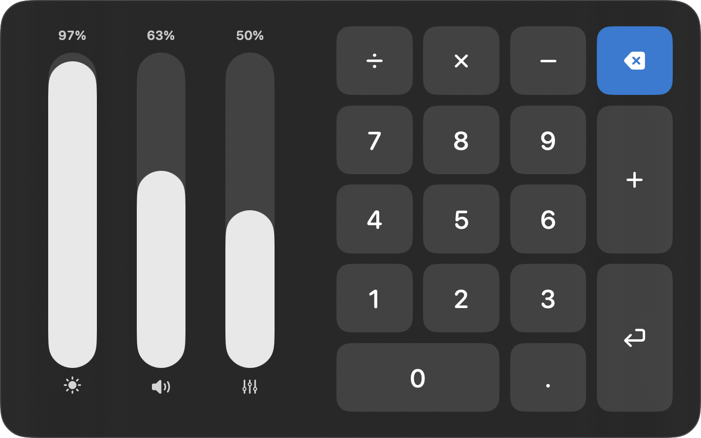

# TouchDeck

[](https://github.com/tsvetowntopalov/touchdeck-macos/actions/workflows/build.yml)


[](LICENSE)

**Turn your Mac's trackpad into a touchscreen for a floating control deck.**

Hold **⌃⌥ (Control + Option)** and a deck appears in the middle of the screen: three vertical sliders (brightness, volume, custom) and a numpad. The trackpad maps 1:1 onto the deck, so you reach a control by putting your finger where it is, just like a touchscreen. Let go of ⌃⌥ and the deck disappears.



## Features

- **Absolute touch input.** Wherever your finger is on the trackpad, a dot shows where it is on the deck. No pointer to steer.
- **Sliders like Control Center.** Put a finger on a slider column and drag to set its value directly.
- **Numpad that types anywhere.** Keys go to whatever app you were using. The deck never takes focus.
- **Safe while it's up.** The cursor is hidden and frozen, and every click and scroll is blocked, so nothing underneath gets clicked.
- **Menu-bar only.** No Dock icon, no window. A ✋ icon in the menu bar shows its status.
- **Works everywhere.** Shows on every Space and over full-screen apps.

## Requirements

- macOS 14 Sonoma or later
- A Mac with a built-in trackpad or a Magic Trackpad
- Xcode 15 or later, and [XcodeGen](https://github.com/yonaskolb/XcodeGen) to build

## Install

There is no prebuilt download yet, so build it from source:

```bash
git clone https://github.com/tsvetowntopalov/touchdeck-macos.git
cd touchdeck-macos
brew install xcodegen
make run
```

`make run` generates the Xcode project, builds a Debug app into `build/` and launches it. Use `make open` instead to work in Xcode (then press ⌘R).

### Grant Accessibility

TouchDeck needs **Accessibility** permission to read the hotkey, block clicks and type keys. On first launch macOS asks for it:

1. Click **Open System Settings** in the prompt, or go to **System Settings → Privacy & Security → Accessibility**.
2. Switch **TouchDeck** on.

You don't need to relaunch: TouchDeck checks every couple of seconds and starts the hotkey on its own. Click the ✋ menu-bar icon to confirm you see **✓ Accessibility granted** and **✓ Hotkey active**.

### Keep the permission across rebuilds (optional)

By default the app is signed ad-hoc ("Sign to Run Locally"), so it builds without an Apple account. The catch is that every rebuild gets a new identity, and macOS silently drops the Accessibility grant.

If you have an Apple Development certificate (a free Apple account in Xcode is enough), sign with your team instead:

```bash
cp Config/Local.xcconfig.example Config/Local.xcconfig
# edit Config/Local.xcconfig and set DEVELOPMENT_TEAM to your team ID
```

`Config/Local.xcconfig` is git-ignored, so your team ID stays on your machine.

## Usage

| While holding ⌃⌥ | Result |
|---|---|
| Put a finger on a slider column and drag | Sets the value directly, like Control Center |
| Quick tap on a key (under 250 ms, no drag) | Types that key into the frontmost app |
| Rest a finger on a key, then physically click | Types that key. Handy when you're sliding around to aim |
| Release ⌃⌥ | Deck hides, cursor comes back |

## Customizing

### Layout

All geometry lives in `DeckLayout.makeControls()` in [`TouchDeck/Model/DeckLayout.swift`](TouchDeck/Model/DeckLayout.swift). Rects are in 0…1 panel space with the origin at the top left, and both the view and hit-testing read them, so they can't drift apart.

To add a control, add a `DeckKey` or `SliderID` case, place it in `makeControls()`, and handle it in [`DeckActions`](TouchDeck/Actions/DeckActions.swift).

### Hotkey

Set `EventTap.activationModifiers` in [`TouchDeck/Input/EventTap.swift`](TouchDeck/Input/EventTap.swift). It's an exact match on ⌃⌥⌘⇧, so `[.maskCommand, .maskAlternate]` means ⌘⌥.

## How it works

```
MultitouchSupport.framework (private)
        │  raw fingers: id, x/y 0..1, state, ~100 Hz, global
        ▼
MultitouchManager ──► TouchRouter ──► DeckState (@Published) ──► DeckView (SwiftUI)
                         │   ▲                                      in OverlayPanel
                         │   │ click                                (non-activating NSPanel)
                         ▼   │
                    DeckActions          EventTap (CGEventTap, session level)
                    ├ VolumeControl      ├ ⌃⌥ held → show / hide
                    ├ BrightnessControl  ├ freeze + hide cursor, swallow pointer events
                    └ KeyPoster          ├ physical click → router.handleClick()
                                         └ strip ⌃⌥ from keys we post
```

| File | Role |
|---|---|
| `Bridging/TouchDeck-Bridging-Header.h` | `MTTouch` struct layout (types only, nothing linked) |
| `Input/MultitouchManager.swift` | Loads MultitouchSupport at runtime and registers a frame callback on every trackpad |
| `Input/EventTap.swift` | Hotkey, cursor freeze, click capture |
| `Input/CursorHider.swift` | Hides the cursor even though TouchDeck is never the frontmost app |
| `Input/TouchRouter.swift` | Fingers → hover, tap, slider drag and click logic |
| `Model/DeckLayout.swift` | **Single source of geometry**, shared by the view and hit-testing |
| `Model/DeckState.swift` | Observable UI state |
| `UI/OverlayPanel.swift` | Floating, click-through, never-focused panel on all Spaces |
| `UI/DeckView.swift` | The translucent deck |
| `Actions/*` | CoreAudio volume, DisplayServices brightness, key posting |

Private frameworks are loaded with `dlopen`/`dlsym` at runtime, so nothing links against them at build time.

## Troubleshooting

**Nothing happens when I hold ⌃⌥.** Click the ✋ icon. If it shows **✗ Accessibility needed** or **✗ Hotkey inactive**, the permission is missing or stale. This usually happens after a rebuild with ad-hoc signing. Reset it and grant it again:

```bash
tccutil reset Accessibility com.touchdeck.app
```

Then quit TouchDeck from its menu, run `make run`, and switch it on once when macOS asks.

**I can't find the ✋ icon.** On a MacBook with a notch, menu-bar icons can be hidden behind it. Quit a few other menu-bar apps, or use a menu-bar manager to reveal it.

**Mission Control or Spaces fire while I use the deck.** Three- and four-finger system gestures reach the Dock before any app can block them. Turn them off in **System Settings → Trackpad → More Gestures**, or use one or two fingers.

## Known limitations

- **Private APIs.** MultitouchSupport, DisplayServices and the cursor-hiding call are undocumented and can break in a macOS update. For the same reason TouchDeck can't be sandboxed or shipped on the Mac App Store; distribute it signed with a Developer ID and notarized instead.
- **Brightness** only controls the built-in display. External monitors need DDC/CI (see [MonitorControl](https://github.com/MonitorControl/MonitorControl)).
- **Palm rejection is basic.** A thumb resting on the trackpad counts as a finger.
- **The custom slider** isn't wired to anything yet. Hook it up in `DeckActions`.

## Roadmap ideas

- Toggle mode: tap ⌃⌥ to lock the deck open
- Per-app layouts
- Haptic feedback with `NSHapticFeedbackManager`
- Pressure-to-click on Force Touch trackpads
- Signed, notarized release builds

## Contributing

Issues and pull requests are welcome. See [CONTRIBUTING.md](CONTRIBUTING.md).

## License

[MIT](LICENSE) © 2026 Tsvetan Topalov
